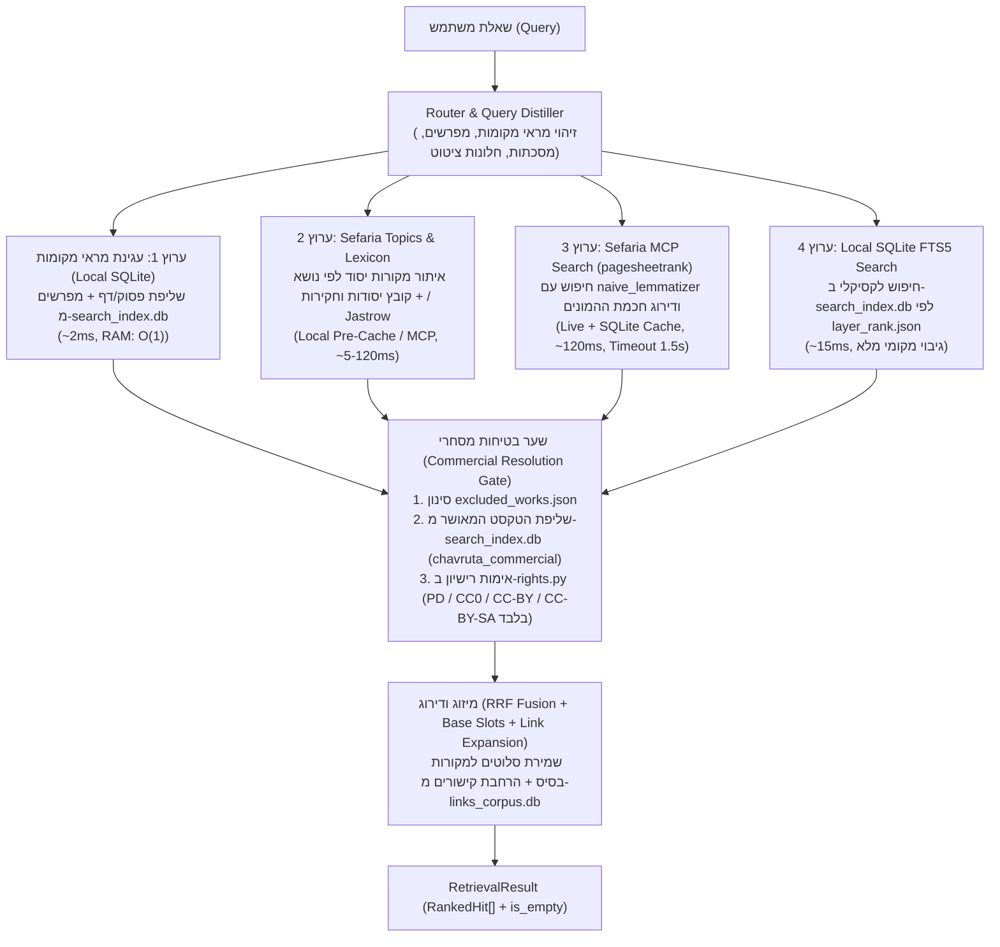

# תכנון הנדסי: מעבר לארכיטקטורת Sefaria MCP + SQLite (שרת קל בעלות דולרים בודדים)

**תאריך:** 2026-10-19  
**סטטוס:** תכנון ומחקר (לפני ביצוע טסטים והשוואת A/B מול Qdrant)

---

## 1. תקציר מנהלים והמטרה ההנדסית

המטרה היא להחליף את שני הרכיבים הכבדים והיקרים ביותר בשרת הנוכחי של **Chavruta.AI**:
1. **מודל האמבדינג `bge-m3` על ה-CPU** (בתוך קונטיינר ה-`api` — צורך **~4.6GB RAM**, מאריך את עליית השרת ב-120 שניות, וחונק את ה-CPU למשך **0.6–8.7 שניות** בכל שאילתה).
2. **שרת הווקטורים `Qdrant`** (~2.5 מיליון נקודות ו-~6.1 מיליון וקטורים — דורש **~23GB SSD** ועוד ~20GB פנויים בזמן שחזור, וצורך **2GB–16GB RAM**).

**היעד החדש:**
מעבר לשרת VPS זעיר (**1–2 vCPU, 2GB RAM, בעלות של $4–$6 לחודש**) המבוסס על שילוב של:
* **כלי ה-MCP וה-API של ספריא (`Sefaria/sefaria-mcp`)** לצורך איתור חכם ודירוג מראי מקומות (`ref`s).
* **מסדי ה-SQLite המקומיים הקיימים שלנו (`data/search_index.db`, `data/links_corpus.db`, `data/ref_index.db`)** לצורך שליפת הטקסט המסחרי החוקי, חיפוש לקסיקלי מהיר (FTS5) והרחבת קישורים ב-**O(1) RAM (<100MB)**.

---

## 2. ניתוח תנאי השימוש והרישוי של Sefaria MCP (והפתרון המשפטי)

### 2.1 שלוש שכבות הרישוי בספריא
1. **קוד שרת ה-MCP (`github.com/Sefaria/sefaria-mcp`):**
   * מופץ ברישיון **MIT** פתוח לחלוטין (בניגוד לליבת האתר של ספריא שהיא GPL-3.0).
   * **משמעות:** מותר לנו להטמיע, לשנות ולהריץ את קוד ה-MCP שלהם ישירות בתוך ה-Backend שלנו (`app/api.py` / `src/chavruta/retrieval/`), גם במוצר מסחרי.
2. **תנאי השימוש ב-API החי של ספריא (`sefaria.org/terms`, עדכון אפריל 2026):**
   * השירות פתוח ללא אימות (`no auth`), אך סעיף 3 אוסר על גרידה מסיבית (Bulk Scraping/Crawling) או ניצול מסחרי ישיר של השירות ללא רשות מראש.
   * **משמעות:** אין לבצע הורדה גורפת דרך ה-API החי, ואין להפציץ את שרתי ספריא בבקשות מיותרות כשאפשר לשלוף את הטקסט מהדיסק המקומי שלנו.
3. **מלכודת זכויות היוצרים של המהדורות (`versionTitle`):**
   * כפי שמפורט ב-`NOTICE.md`, `docs/COMMERCIAL_CORPUS.md` ו-`src/chavruta/corpus/rights.py`, הרישיון בספריא נקבע **לפי מהדורה ושפה (`title, language, versionTitle`)**.
   * שרת ה-MCP הרשמי של ספריא (`sefaria_mcp/logic.py`) מושך בברירת מחדל את `version=source` / `version=english` — שלגבי התלמוד הבבלי (מהדורת William Davidson), פניני הלכה בעברית, שטיינזלץ ועוד, מדובר במהדורות **`CC-BY-NC` או כל הזכויות שמורות**, שאסור להציג למשתמש במוצר מסחרי!
   * בנוסף, ה-MCP של ספריא מחזיר ספרים שהוחרגו במכוון מהקורפוס שלנו ב-`src/chavruta/corpus/data/excluded_works.json` (*ספר היובלים*, *צוואות השבטים*, *מלחמות השם*).

### 2.2 הפתרון ההנדסי-משפטי: `"Search & Rank via Sefaria → Resolve Commercial Text Locally"`
* **אנחנו לעולם לא מציגים למשתמש טקסט גולמי שחזר מ-Sefaria MCP!**
* ה-MCP/API של ספריא משמש **אך ורק לשלב ה-Discovery והדירוג**: הוא מחזיר לנו אילו מראי מקומות (`ref`s, כגון `Bava_Metzia.21b.1` או `Shulchan_Arukh,_Orach_Chayim.279.1`) הם המדויקים והחשובים ביותר לשאלה.
* ברגע שיש לנו את רשימת ה-`ref`ים, **שליפת הטקסט עצמו (`Text Resolution`) מתבצעת ב-100% מתוך מסד ה-SQLite המקומי שלנו (`data/search_index.db`)** שמכיל **אך ורק את הקורפוס המסחרי המאומת (`chavruta_commercial`)**!
* אם `ref` מסוים אינו קיים ב-SQLite המקומי, הוא נבדק מול `license_for_ref()` ב-`src/chavruta/corpus/refs.py` (המבוסס על `licenses.json`) ומול `excluded_works.json` — אם אין לו מהדורה מסחרית מאושרת (`PD`, `CC0`, `CC-BY`, `CC-BY-SA`), הוא נחסם (`Fail-Closed`).

---

## 3. הבהרה קריטית: מתי פונים לספריא בזמן אמת (Live) ומה תפקיד ה-Cache?

כשמשתמש שואל שאלה חדשה, איך המערכת יודעת מה המקור בלי לפנות לספריא?
התשובה היא **שילוב של 4 מקורות מידע**, שרק אחד מהם דורש פנייה חיה לספריא בשאלה חדשה:

### 1. מה שכבר נמצא אצלנו מקומית על הדיסק (0 פניות לספריא, ~1–15ms):
* **כל הטקסטים המסחריים (`data/search_index.db`):** חיפוש מילולי מהיר (SQLite FTS5) על כל 2.5 מיליון הקטעים, ממוין לפי סדר הלימוד (`layer_rank.json`), פלוס שליפת כל פסוק/דף גמרא ומפרשיו לפי `ref` (`Named-Ref Anchoring`).
* **גרף הקישורים (`data/links_corpus.db` + `data/ref_index.db`):** כל הקישורים בין פסוקים, גמרא, רש"י, תוספות ושו"ע נמצאים כבר מקומית על הדיסק.

### 2. מה שניתן להוריד מראש פעם אחת לטבלה מקומית (`Pre-cached Static Knowledge`, 0 פניות בזמן ריצה):
* **גרף הנושאים של ספריא (`Topics Ontology` — `/api/all-topics` ו-`/api/ref-topic-links`):**
  * בספריא יש ~5,700 נושאים מתויגים אנושית (למשל *"חשמל בשבת"*, *"יאוש שלא מדעת"*, *"פדיון שבויים"*, *"לשון הרע"*), שכל אחד מהם ממופה למקורות היסוד הקנוניים ביותר שלו.
  * כל המיפוי הזה שוקל **פחות מ-30MB**! ניתן לשמור אותו מראש בטבלת SQLite מקומית (`topics_index.db`), כך שגם כשמשתמש שואל שאלה מושגית/מודרנית, המערכת מוצאת מיד את מקורות היסוד של הנושא **מקומית ב-1ms בלי לצאת לרשת!**

### 3. מתי כן פונים ל-Sefaria MCP בזמן אמת (Live HTTP Request, ~100–200ms)?
* כאשר מגיעה **שאלה חופשית חדשה**, אנו שולחים במקביל לחיפוש ה-SQLite המקומי שלנו קריאת HTTP קלה אל `text_search` של ספריא (`/api/search-wrapper/es8`) או `search_in_dictionaries`.
* **למה כדאי לפנות אליהם בשאלה חדשה?** כי מנוע ה-ElasticSearch של ספריא מחזיק שני פיצ'רים יקרי ערך:
  1. **`pagesheetrank`:** דירוג כל מקור לפי כמות הפעמים שהוא צוטט בדפי מקורות אנושיים בספריא (מביא תמיד את הסוגיה המרכזית במקום מדרש עלום).
  2. **`naive_lemmatizer`:** למטייזר עברי/ארמי שמזהה שורשים והטיות.
* **ומה קורה אם ספריא איטית או נופלת?** יש Timeout קשיח של `1.5s` — אם ספריא לא ענתה בזמן, המערכת ממשיכה מיד עם תוצאות ה-SQLite המקומי (`search_index.db` + `topics_index.db` + `links_corpus.db`) בלי שהמשתמש ירגיש תקלה!

### 4. מה תפקיד ה-Query Cache (`data/sefaria_mcp_cache.db`)?
* כל תשובת JSON שחוזרת מה-MCP של ספריא (חיפוש, מילון, או נושא) נשמרת ב-SQLite מקומי לפי המפתח `(tool_name, normalized_query)`.
* **בטסטים וב-Eval (`run_eval.py`):** מאפשר להריץ אלפי שאלות שוב ושוב במהירות שיא (0ms) ובדטרמיניסטיות מוחלטת בלי להפציץ את שרתי ספריא.
* **בפרודקשן:** מונע פניות כפולות לספריא כשמשתמשים שואלים שאלות נפוצות, או כשהמודל בלולאת ה-`===NEED_SOURCES===` מחפש שוב מונחים תלמודיים קלאסיים (כגון `DICT: רובא דאיתא קמן` או `SEARCH: יאוש שלא מדעת`).

---

## 4. ארכיטקטורת המטרה (`McpSqliteRetriever`)

תרשים הזרימה של בקשת אחזור ב-`McpSqliteRetriever` (מחליף את `HybridRetriever` ללא `bge-m3` וללא `Qdrant`):

---

## 5. תוכנית עבודה מפורטת (שלב אחר שלב לפני ההמרה)

### שלב א': פיתוח המודולים החדשים (ללא פגיעה בקוד הקיים)
כל הקוד החדש ייכתב במקביל לקוד הקיים ויופעל **רק** כאשר משתנה הסביבה `CHAVRUTA_RETRIEVER_MODE=mcp_sqlite` מוגדר:

1. **`src/chavruta/retrieval/sefaria_mcp_client.py`**
   * מימוש לקוח קל ומהיר מול ה-endpoints שבהם משתמש `Sefaria/sefaria-mcp`:
     * `search_texts(query, filters, size)` — מול `/api/search-wrapper/es8` עם `sort_fields: ["pagesheetrank"]` ו-`field: "naive_lemmatizer"`.
     * `search_in_book(query, book_title, size)` — חיפוש ממוקד בתוך ספר/מסכת.
     * `search_dictionaries(query)` — מול Jastrow, Klein ו"קובץ יסודות וחקירות".
     * `get_topic_sources(query_or_slug)` — שליפת מקורות הליבה של נושא מתוך ה-Topics API של ספריא.
     * `get_links(ref)` — שליפת קישורים מספריא (כשהקישור חסר ב-`links_corpus.db` המקומי).
   * כולל שכבת Cache שקופה ב-SQLite (`data/sefaria_mcp_cache.db`) ו-Timeout קשיח.

2. **`src/chavruta/retrieval/mcp_sqlite.py` (`McpSqliteRetriever`)**
   * מממש את הפרוטוקול `Retriever` מ-`src/chavruta/retrieval/base.py`.
   * מחבר את 4 הערוצים (Anchoring מקומי, Sefaria Topics/Dictionaries, Sefaria `pagesheetrank` Search, ו-SQLite FTS5 מקומי).
   * מעביר כל `ref` דרך **שער הבטיחות המסחרי** (שליפת `text_he`, `text_en`, `license`, `version_title` מתוך `data/search_index.db` ו-`license_for_ref`).
   * מבצע RRF Fusion, שומר סלוטים למקורות בסיס (`_BASE_SLOTS`), מרחיב קישורים דרך `LinkExpander`, ומחשב את שער הכנות (`is_empty`).

3. **עדכון `src/chavruta/config/profile.py` ו-`src/chavruta/pipeline/pipeline.py`**
   * הוספת `retriever_mode: str = "qdrant"` (`CHAVRUTA_RETRIEVER_MODE` — ערכים: `"qdrant"` | `"mcp_sqlite"`).
   * כאשר `retriever_mode == "mcp_sqlite"`, הפונקציה `build_backends()` ב-`pipeline.py` **לא טוענת את `BgeM3Embedding` ולא יוצרת חיבור ל-`QdrantStore`**, אלא בונה את `McpSqliteRetriever` ישירות מעל קובצי ה-SQLite המקומיים.
   * שדרוג `_build_source_fetcher()` ב-`pipeline.py` ו-`SOURCE_REQUEST_INSTRUCTION` ב-`src/chavruta/llm/agentic.py` כך שבמצב `mcp_sqlite` המודל יוכל לבקש בלולאת `===NEED_SOURCES===` גם פקודות ממוקדות:
     * `REF: <ref>` — שליפת מקור ומפרשיו.
     * `BOOK: <book> | <query>` — חיפוש בתוך ספר ספציפי.
     * `TOPIC: <topic>` — שליפת מקורות יסוד לנושא.
     * `DICT: <term>` — פירוש מונח במילון ארמי / קובץ יסודות וחקירות.

---

### שלב ב': מערך הטסטים והמדידה (לפני קבלת החלטה על המרה)

לפני שמחליפים את `Qdrant` בפרודקשן, נריץ 4 סדרות של בדיקות ונשווה את המספרים:

#### 1. בדיקות יחידה (`tests/unit/test_mcp_sqlite_retriever.py`) — ללא רשת וללא עלות
* **בדיקת סינון מסחרי (`test_commercial_gate_blocks_nc_and_resolves_local`):** מוודאת שגם אם ספריא מחזירה תוצאה ממהדורת William Davidson (`CC-BY-NC`) או מפניני הלכה בעברית, המשתמש מקבל אך ורק את הטקסט המסחרי מ-`search_index.db` (ויקיטקסט) או שהתוצאה מסוננת אם אין לה מהדורה מסחרית.
* **בדיקת ספרים מוחרגים (`test_excluded_works_blocked`):** מוודאת ש-*ספר היובלים*, *צוואות השבטים* ו-*מלחמות השם* נחסמים תמיד.
* **בדיקת שרידות (`test_sefaria_timeout_falls_back_to_local_fts5`):** מוודאת שכש-Sefaria API מחזיר שגיאה או Timeout, `McpSqliteRetriever` מחזיר תוצאות תקפות מ-`search_index.db` המקומי תוך פחות מ-50ms.
* **בדיקת כנות (`test_honest_no_source_when_empty`):** מוודאת ששאלה ללא תוצאות מחזירה `is_empty=True`.

#### 2. השוואת דיוק ראש-בראש (`scripts/benchmark_mcp_vs_qdrant.py`) — `--retrieval-only` ($0 עלות LLM)
הרצת `scripts/run_eval.py --retrieval-only` עם שני המנועים (`qdrant` מול `mcp_sqlite`) על כל סטי האמת של המערכת:

| קובץ Eval | כמות שאלות | מה נמדד? | יעד להצלחה |
| :--- | :--- | :--- | :--- |
| `eval/torah_questions_v1.jsonl` | 26 | שאלות בניסוח אנושי יומיומי מול לשון הסוגיה | שיפור או שוויון ב-`retrieval@K` וב-`source_coverage` |
| `eval/regressions_v1.jsonl` | מקרי קצה | באגים היסטוריים (מפרשים, ציטוטים, המשך שיחה) | 0 רגרסיות |
| `eval/user_questions_v1.jsonl` | שאלות משתמשים | שאלות אמיתיות שנשאלו בפרודקשן | שיפור ב-`MRR` (מקורות יסוד מדורגים גבוה יותר בזכות `pagesheetrank`) |
| `eval/tanakh_v1.jsonl` | תנ"ך + שאלות סרק | דיוק בתנ"ך ומפרשיו + `honesty_rate` | `honesty_rate == 100%` |
| `eval/harvested_pairs_v1.jsonl` | מדגם של 400 זוגות | בדיקה סטטיסטית רחבה (`Recall@8` ו-`MRR`) | בדיקת מובהקות סטטיסטית |

#### 3. השוואת מהירות, מקביליות וזיכרון (`Latency & RAM Benchmark`)
באותו סקריפט נמדוד ונדפיס טבלת השוואה של:
* **זמן עליית השרת (Cold Start):** מ-~120 שניות (טעינת `bge-m3`) ל-**<3 שניות**.
* **צריכת RAM של תהליך ה-API:** מ-~4,800MB ל-**<250MB**.
* **Latency לשאילתה יחידה (p50 / p95):** השוואת `Qdrant + bge-m3` מול `McpSqliteRetriever` (גם ב-Cold Network וגם ב-Warm Cache).
* **Latency תחת עומס (8 בקשות במקביל):** הוכחה שהסרת `bge-m3` מבטלת את הפקק של `_PriorityGate` (שמאט היום בקשות מקביליות ל-7–14 שניות).

#### 4. בדיקת איכות תשובות מלאה עם LLM (רק באישור מפורש שלך)
* לאחר שנראה שהאחזור (`--retrieval-only`) מהיר ומדויק יותר, נבחר 5–10 שאלות מאתגרות ונריץ אותן מקצה לקצה (כולל לולאת ה-`===NEED_SOURCES===` המשודרגת) כדי להשוות את איכות התשובות והציטוטים בין שני המנועים.

---

## 6. שלב ג': תוכנית ההמרה של השרת (רק אחרי שהטסטים מוכיחים שיפור)

ברגע שהמספרים בטסטים מאשרים ש-`mcp_sqlite` מנצח או משתווה בדיוק ומנצח בגדול במהירות ובזיכרון:
1. ב-`docker-compose.yml`:
   * משנים את `CHAVRUTA_RETRIEVER_MODE=mcp_sqlite`.
   * מורידים את שירות `qdrant` ואת ה-volume הכבד `qdrant_storage` (~23GB).
   * ב-`docker/Dockerfile.endpoint`: מסירים את התלויות הכבדות `torch`, `sentence-transformers`, `FlagEmbedding`, `qdrant-client` (מקטין את ה-Docker Image ב-~3.5GB!).
2. **תוצאה סופית על השרת:**
   * כל המערכת (`nginx` + `ui` + `api` + `search` על SQLite) רצה בקלות על שרת של **1–2GB RAM ו-1–2 vCPU בעלות של $4–$6 לחודש**, עם זמני תגובה מהירים פי 5–10 וללא פקקי CPU.
